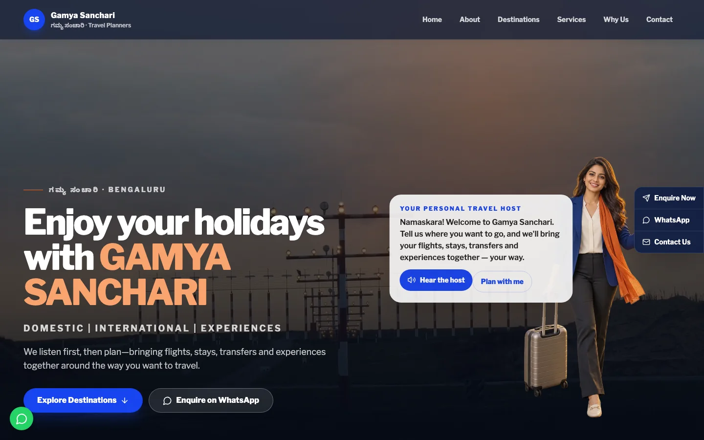

# Gamya Sanchari

An accessible, cinematic multi-page travel website for Gamya Sanchari, a Bengaluru-based travel planning service. The site is statically exported, uses no database or environment variables, and sends every enquiry through an explicit WhatsApp action.



## Highlights

- Twenty published routes across destinations, sample journeys, experiences, planning, journal, brand and contact content
- Responsive, keyboard-operable destination and journey filters from 360 px upward
- Local, optimized hero video with poster fallback and a poster-first mobile experience
- Timed plane-to-host welcome with captions, opt-in browser speech, and reduced-motion handling
- Customizable sample journeys with day-by-day accordions, contextual planner handoff and persistent mobile actions
- Six-step trip planner with safe session restoration, edit/review flow and explicit WhatsApp handoff
- Accessible enquiry modal with focus trapping, Escape/overlay close, and trigger-focus restoration
- WhatsApp-only enquiry and callback flows; form values are never stored or submitted to this site
- Reduced-motion support, keyboard navigation, semantic landmarks, metadata, sitemap, robots, manifest, and `TravelAgency` JSON-LD
- Static Next.js export suitable for CDN hosting

## Local development

Requires Node.js 20 or newer.

```bash
npm ci
npm run dev
```

Open `http://localhost:3000`. No `.env` file or external service is required.

## Quality commands

```bash
npm test -- --run   # Vitest unit and component tests
npm run lint        # ESLint
npm run build       # Static export to out/
npm run test:e2e    # Playwright desktop and 360 px journeys
node scripts/verify-assets.mjs # Media, credits, content and route-registry audit
```

The release audit also uses Lighthouse against seven representative routes on the compressed static export. The minimum verified scores were:

| Profile | Performance | Accessibility | Best Practices | SEO |
| --- | ---: | ---: | ---: | ---: |
| Mobile | 92 | 96 | 100 | 100 |
| Desktop | 96 | 96 | 100 | 100 |

## Architecture

```text
app/                 App Router pages, detail routes, metadata, robots and sitemap
components/          Shared editorial, filtering, planner, motion and accessibility UI
components/enquiry/  Shared accessible enquiry provider, modal, and callback form
constants/           Canonical brand details and typed travel content
lib/                 Content lookup, metadata, planner normalization and WhatsApp URLs
e2e/                 Playwright browser journeys
public/              Licensed, optimized local media and web manifest
scripts/             Release asset verification
```

`next.config.mjs` uses `output: "export"` and unoptimized local images, so the deployed artifact contains only HTML, CSS, JavaScript, fonts, and media. There are no Server Actions, API routes, middleware, authentication, remote image optimization, or persistent data stores.

### Route map

- `/`, `/about/`, `/contact/`, `/experiences/`, `/plan-my-trip/`
- `/destinations/` and five destination detail routes
- `/packages/` and four customizable journey detail routes
- `/journal/` and three evergreen guide routes

The typed collections in `constants/travel.ts` drive cards, detail generation, metadata and the sitemap. `lib/metadata.ts` is the canonical registry for published URLs.

### Privacy

Enquiry fields remain in browser memory only. Submitting a form constructs a prefilled `https://wa.me/918073254766` URL and opens WhatsApp in a new tab; the website does not transmit, log, or retain the entered details.

The trip planner additionally saves its draft in the current tab's `sessionStorage` so visitors can move between steps without losing answers. It is not sent anywhere until the visitor explicitly opens WhatsApp, and it disappears when the browser session is cleared.

### Motion and accessibility

One motion policy controls page enhancement, reveal distance, route drawing, smooth scrolling and the cinematic announcement. `prefers-reduced-motion` removes non-essential movement while preserving all final content. Every route includes skip navigation, visible keyboard focus, semantic landmarks and touch targets designed for 360 px screens.

### Release workflow

Run `npm ci`, then the unit suite, asset verifier, production build and Playwright suite. Deploy only the resulting verified commit through the existing Vercel project; after deployment, confirm every sitemap URL returns successfully and complete the planner only as far as the outbound WhatsApp preview without sending a message.

### Dependency scope

The implementation intentionally uses Next.js 14.2.35. Current npm advisories include server-runtime paths in Next.js 14; this project deploys only the static `out/` artifact and does not ship the affected Next.js server, image optimizer, middleware, rewrites, or Server Actions. A future framework-major upgrade should still be scheduled when the Next.js 14 requirement is lifted.

## Credits

The initial component-oriented base was imported from [`adrianhajdin/travel_ui_ux`](https://github.com/adrianhajdin/travel_ui_ux) at commit [`1e9952d`](https://github.com/adrianhajdin/travel_ui_ux/commit/1e9952d316c7da1f592c62b95e3c6b4ed3f8ec50), then fully redesigned and rebuilt for Gamya Sanchari.

Photography and video sources are listed in [`docs/media-credits.md`](docs/media-credits.md). All original media derivatives are stored locally in `public/`.

## License

Project code is available under the [MIT License](LICENSE). Third-party media remains subject to the licenses identified in the media credits.
